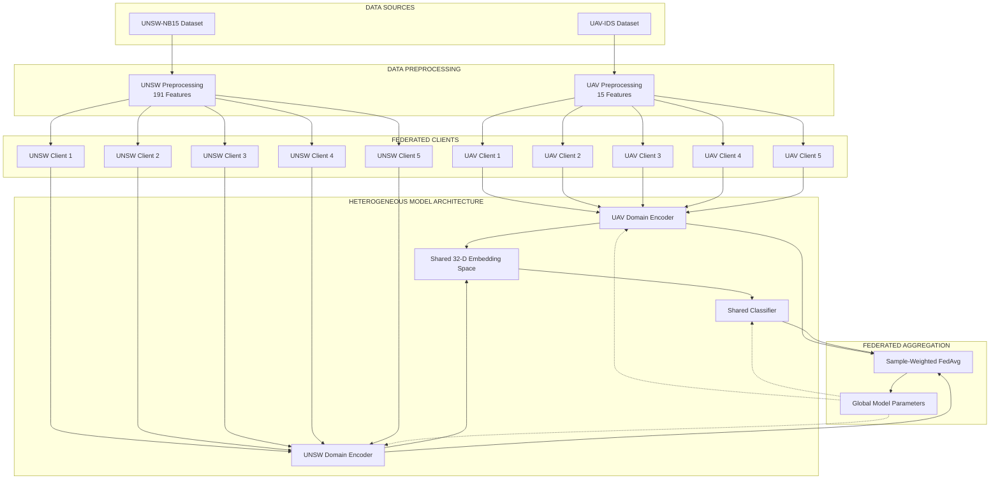
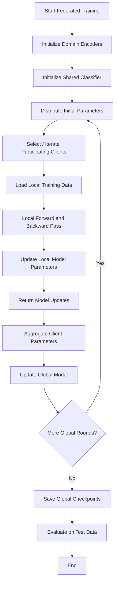
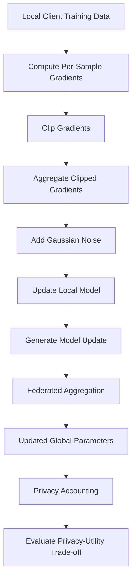
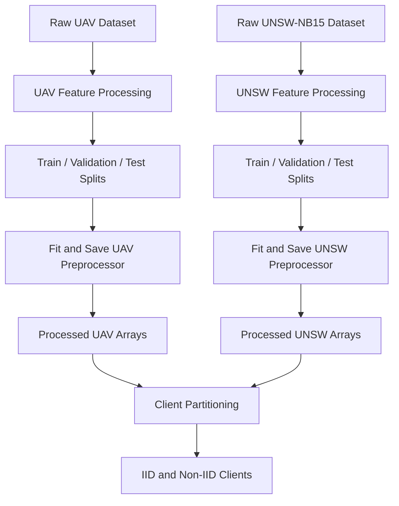
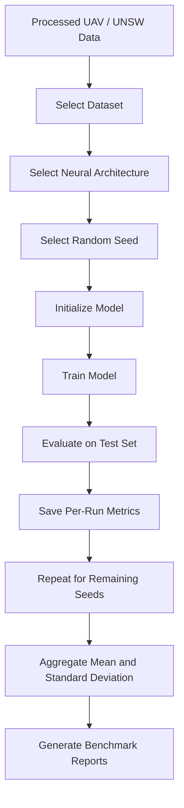
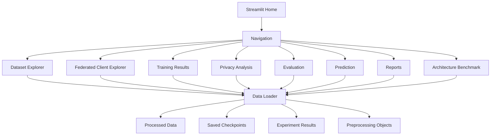
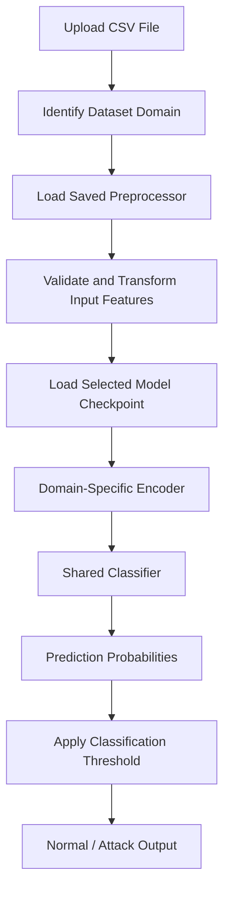

# HFL-DSE-DP
### Privacy-Preserving Feature-Heterogeneous Federated Learning for Intrusion Detection Across UAV and Enterprise Networks

<p align="center">
  <strong>Federated Learning · Differential Privacy · Intrusion Detection · Deep Learning</strong>
</p>

<p align="center">
  <a href="https://github.com/Prakash3009/HFL-DSE-DP">
    
  </a>
  
  
  
  
</p>

---

## Table of Contents

1. [Project Overview](#1-project-overview)
2. [Problem Statement](#2-problem-statement)
3. [Research Objectives](#3-research-objectives)
4. [Proposed System Architecture](#4-proposed-system-architecture)
5. [Federated Learning Methodology](#5-federated-learning-methodology)
6. [Differential Privacy Framework](#6-differential-privacy-framework)
7. [Datasets and Preprocessing](#7-datasets-and-preprocessing)
8. [Independent Architecture Benchmark](#8-independent-architecture-benchmark)
9. [Experimental Results](#9-experimental-results)
10. [Repository Structure](#10-repository-structure)
11. [Technology Stack](#11-technology-stack)
12. [Installation and Environment Setup](#12-installation-and-environment-setup)
13. [Dataset Preparation](#13-dataset-preparation)
14. [Running the Project](#14-running-the-project)
15. [Interactive Dashboard](#15-interactive-dashboard)
16. [Prediction and Inference](#16-prediction-and-inference)
17. [Output Files and Artifacts](#17-output-files-and-artifacts)
18. [Reproducibility](#18-reproducibility)
19. [Limitations and Future Work](#19-limitations-and-future-work)
20. [References and Acknowledgements](#20-references-and-acknowledgements)

---

# 1. Project Overview

HFL-DSE-DP is a research implementation of **feature-heterogeneous federated learning with differential privacy for intrusion detection across heterogeneous network environments**.

The project investigates collaborative intrusion detection across two different network domains:

- **Unmanned Aerial Vehicle (UAV) networks**
- **Enterprise computer networks**

These environments have different feature spaces, data distributions, and network characteristics. Consequently, directly combining their datasets into a single conventional machine learning model is not straightforward.

This project addresses that challenge through domain-specific feature encoders and a shared classification network.

Each participating client processes its local dataset, transforms its features into a common latent representation, and contributes to collaborative model optimization through federated aggregation.

Differential privacy is additionally investigated to reduce the exposure of individual training records during optimization.

The repository also contains an independent neural architecture benchmarking pipeline and an interactive Streamlit application for exploring the experimental results.

### Project at a glance

| Component | Implementation |
|---|---|
| Research area | Feature-heterogeneous federated learning |
| Application | Network intrusion detection |
| Network domains | UAV and enterprise |
| Federated clients | 10 |
| Clients per domain | 5 |
| Data partitioning | IID and Non-IID |
| Non-IID strategy | Dirichlet distribution |
| Domain encoders | Separate UAV and UNSW encoders |
| Shared representation | 32-dimensional embedding |
| Classification | Binary normal/attack |
| Privacy mechanism | Differentially private optimization |
| Privacy accounting | RDP and PRV |
| Independent benchmark | 10 architectures |
| Interactive application | Streamlit dashboard |

---

# 2. Problem Statement

Traditional centralized intrusion detection systems require data to be collected and combined at a central location.

This approach can create challenges:

1. Network data may contain sensitive information.
2. Different organizations may not be willing or permitted to share raw traffic records.
3. Different network environments may use different feature representations.
4. Non-IID data distributions can make collaborative model training difficult.
5. Model updates can potentially reveal information about local training records.

A conventional federated learning system generally assumes that participating clients have compatible model input representations.

However, the UAV and UNSW-NB15 datasets used in this project have different input dimensions:

| Dataset | Input dimensions |
|---|---:|
| UAV-IDS | 15 |
| UNSW-NB15 | 191 transformed features |

Therefore, a shared model cannot directly consume the original feature vectors from both domains.

### Research problem

How can multiple clients from heterogeneous network domains collaboratively train an intrusion detection model using different local feature spaces, while investigating differential privacy to reduce the disclosure of individual training records?

### Proposed approach

The project uses:

- Domain-specific feature encoders.
- A shared latent representation.
- A common binary classifier.
- Federated averaging.
- Differentially private training experiments.
- Separate evaluation across both network domains.

---

# 3. Research Objectives

The primary objectives are:

1. Design a feature-heterogeneous federated learning architecture for UAV and enterprise network intrusion detection.
2. Develop domain-specific encoders that map different feature spaces into a common embedding representation.
3. Implement collaborative optimization using federated averaging.
4. Investigate IID and Non-IID client data distributions.
5. Evaluate the effect of differential privacy noise on predictive performance.
6. Compare privacy budgets using RDP and PRV accounting.
7. Benchmark multiple neural architectures on both datasets independently.
8. Develop an interactive application for exploring datasets, model results, privacy metrics, and predictions.

---

# 4. Proposed System Architecture

## 4.1 High-Level Architecture

The proposed system consists of two domain-specific federated learning groups and a shared classification component.



## 4.2 Feature-Heterogeneous Model Architecture

The model uses two domain-specific encoders and one shared classification network.

### UAV Domain Encoder

Input dimension: 15

```text
Input: 15 features
       |
       v
Linear(15, 64)
       |
      ReLU
       |
       v
Linear(64, 32)
       |
      ReLU
       |
       v
Output: 32-dimensional embedding
```

### UNSW Domain Encoder

Input dimension: 191

```text
Input: 191 transformed features
       |
       v
Linear(191, 64)
       |
      ReLU
       |
       v
Linear(64, 32)
       |
      ReLU
       |
       v
Output: 32-dimensional embedding
```

### Shared Classification Network

```text
Input: 32-dimensional embedding
              |
              v
        Linear(32, 32)
              |
             ReLU
              |
           Dropout
              |
              v
        Linear(32, 16)
              |
             ReLU
              |
           Dropout
              |
              v
         Linear(16, 1)
              |
              v
          Logit Output
              |
              v
         Sigmoid Probability
              |
              v
       Normal / Attack
```

The classifier produces a binary prediction:

- `0` — Normal traffic
- `1` — Attack traffic

The model produces logits during training. Sigmoid probabilities are used during inference and threshold-based evaluation.

---

# 5. Federated Learning Methodology

## 5.1 Client Distribution

The system uses two federated domains:

| Domain | Number of clients | Feature dimensions |
|---|---:|---:|
| UAV | 5 | 15 |
| Enterprise (UNSW) | 5 | 191 |
| **Total** | **10** | Heterogeneous |

The clients are created using two partitioning strategies:

- IID: approximately independent and identically distributed client partitions.
- Non-IID: client partitions generated using a Dirichlet distribution.

The Non-IID configuration uses:

\[
\alpha = 0.3
\]

A smaller Dirichlet concentration parameter generally produces more heterogeneous client distributions.

## 5.2 Federated Training Workflow



## 5.3 Federated Averaging

The implementation uses sample-weighted Federated Averaging.

The aggregated model parameters are calculated as:

\[
w^{t+1} =
\sum_{k=1}^{K}
\frac{n_k}{\sum_{j=1}^{K} n_j}
w_k^{t+1}
\]

Where:

- \(w_k^{t+1}\) represents the updated parameters from client \(k\).
- \(n_k\) represents the number of local training samples.
- \(K\) represents the number of participating clients.

Domain-specific encoders are aggregated within their respective domains, while the shared classifier is aggregated across all participating clients.

## 5.4 Federated Experimental Configuration

| Parameter | Value |
|---|---|
| Total clients | 10 |
| Clients per domain | 5 |
| Global rounds | 2 |
| Local epochs | 1 |
| Embedding dimension | 32 |
| Non-IID Dirichlet alpha | 0.3 |
| Aggregation | Sample-weighted FedAvg |
| Classification task | Binary |

**Note:** Two global rounds are used in the current saved experiments. These experiments should not be interpreted as demonstrating convergence.

---

# 6. Differential Privacy Framework

## 6.1 Motivation

Federated learning avoids directly collecting all client training records at a central server, but model updates can still contain information about individual records.

Differential privacy provides a mathematical framework for limiting the influence of an individual training record on the released model.

This project investigates differential privacy through gradient clipping and Gaussian noise during local optimization.

## 6.2 Differential Privacy Workflow



## 6.3 Privacy Configuration

The experiments investigate three noise multipliers.

| Parameter | Configuration |
|---|---|
| Privacy mechanism | DP-SGD |
| Gradient clipping | Enabled |
| Noise distribution | Gaussian |
| Noise multipliers | 0.5, 1.0, 1.5 |
| Delta | \(10^{-5}\) |
| Accounting methods | RDP and PRV |
| Privacy scope | Record-level |

## 6.4 Recorded Privacy Accounting Results

| Noise multiplier | RDP epsilon | PRV epsilon |
|---:|---:|---:|
| 0.5 | 19.5971 | 16.9909 |
| 1.0 | 4.9904 | 4.2925 |
| 1.5 | 2.4091 | 2.0964 |

A higher noise multiplier generally provides a stronger privacy trade-off under the reported configuration, but can reduce model utility.

**Privacy qualification:** These are recorded experimental accounting results, not a production security certification. The historical experiments used `secure_mode=False` and seeded standard randomness rather than cryptographically secure noise generation. The privacy scope is record-level, not client-level. Preprocessing and client construction are outside the reported DP mechanism. Formal privacy claims require validation of the complete mechanism and its assumptions.

---

# 7. Datasets and Preprocessing

The project uses two intrusion detection datasets.

## 7.1 UAV-IDS

The UAV dataset represents intrusion detection in unmanned aerial vehicle network environments.

| Property | Configuration |
|---|---|
| Domain | UAV network |
| Input features | 15 |
| Model input dimension | 15 |
| Task in HFL | Binary classification |
| Preprocessing | Numerical feature transformation and standardization |

## 7.2 UNSW-NB15

UNSW-NB15 represents enterprise network traffic with normal and attack records.

| Property | Configuration |
|---|---|
| Domain | Enterprise network |
| Raw input columns | 41 |
| Transformed input features | 191 |
| Model input dimension | 191 |
| Task in HFL | Binary classification |
| Preprocessing | Numerical transformation and categorical encoding |

## 7.3 Preprocessing Workflow



The processed datasets include:

- Training arrays.
- Validation arrays.
- Test arrays.
- Feature-name metadata.
- Saved preprocessing objects.

The saved preprocessing objects are also used during prediction so that new CSV inputs receive the same transformations as the training data.

### Dataset access

Raw datasets are excluded from the Git repository. Users must obtain the original datasets from their authorized sources.

The repository includes processed data and experiment artifacts where applicable.

---

# 8. Independent Architecture Benchmark

In addition to federated learning, the project contains a separate neural network architecture benchmarking pipeline.

This benchmark evaluates ten neural architectures independently on the two datasets.

**This is a separate non-federated and non-DP multiclass experiment. It is not part of the binary HFL training pipeline.**

## 8.1 Architectures

| No. | Architecture |
|---:|---|
| 1 | Multilayer Perceptron (MLP) |
| 2 | 1D Convolutional Neural Network |
| 3 | ResNet1D |
| 4 | Gated Recurrent Unit (GRU) |
| 5 | Long Short-Term Memory (LSTM) |
| 6 | Bidirectional LSTM |
| 7 | CNN-GRU |
| 8 | CNN-LSTM |
| 9 | Temporal Convolutional Network |
| 10 | Tiny Transformer |

## 8.2 Benchmark Configuration

| Parameter | Value |
|---|---|
| Architectures | 10 |
| Datasets | 2 |
| Random seeds | 42, 123, 2026 |
| Total runs | 60 |
| UAV classes | 5 |
| UNSW classes | 10 |
| Evaluation | Multiclass |

The benchmark reports:

- Weighted precision
- Weighted recall
- Weighted F1-score
- Macro-F1
- Matthews Correlation Coefficient
- Macro one-vs-rest ROC-AUC
- Macro PR-AUC

Results are aggregated using mean and sample standard deviation across the three random seeds.

## 8.3 Benchmark Workflow



The CNN, recurrent, TCN, and Transformer models treat feature vectors as sequences. This does not imply that the datasets contain genuine temporal sequences.

---

# 9. Experimental Results

## 9.1 Non-IID Non-Private Federated Evaluation

The following values represent the saved Non-IID, non-private binary test evaluation with validation-selected thresholds.

| Metric | UAV-IDS | UNSW-NB15 |
|---|---:|---:|
| Decision threshold | 0.85 | 0.90 |
| Accuracy | 96.16% | 85.09% |
| Precision | 97.56% | 84.07% |
| Attack recall | 97.55% | 89.97% |
| Macro-F1 | 94.30% | 84.79% |
| MCC | 0.8859 | 0.6985 |
| False positive rate | 8.94% | 20.89% |
| ROC-AUC | 0.9869 | 0.9460 |
| PR-AUC | 0.9959 | 0.9572 |

### Interpretation

The saved UAV evaluation shows higher accuracy and Macro-F1 than the UNSW-NB15 evaluation.

The UNSW evaluation also has a higher false positive rate. This is an important consideration for practical intrusion detection, where excessive false alarms can reduce operational usefulness.

These results describe the non-private experiment. They must not be presented as the performance of the differentially private models.

## 9.2 Evaluation Metrics

| Metric | Purpose |
|---|---|
| Accuracy | Overall correct predictions |
| Precision | Correctness of positive attack predictions |
| Attack recall | Proportion of attacks detected |
| Macro-F1 | Balanced F1 across classes |
| MCC | Correlation between predictions and true labels |
| FPR | Proportion of normal samples incorrectly classified as attacks |
| ROC-AUC | Ranking performance across classification thresholds |
| PR-AUC | Precision-recall performance |

Detailed experiment results and saved model artifacts are available under `experiments/results/`.

---

# 10. Repository Structure

```text
HFL-DSE-DP/
│
├── dashboard/
│   ├── Home.py
│   ├── pages/
│   │   ├── 1_Datasets.py
│   │   ├── 2_Federated_Clients.py
│   │   ├── 3_Training.py
│   │   ├── 4_Privacy.py
│   │   ├── 5_Evaluation.py
│   │   ├── 6_Prediction.py
│   │   ├── 7_Reports.py
│   │   └── 8_Research_Benchmark.py
│   │
│   ├── components/
│   └── services/
│
├── data/
│   ├── raw/
│   │   ├── uav_ids/
│   │   └── unsw_nb15/
│   │
│   └── processed/
│       ├── uav/
│       │   ├── train.npz
│       │   ├── validation.npz
│       │   ├── test.npz
│       │   ├── feature_names.json
│       │   └── preprocessor.joblib
│       │
│       ├── unsw/
│       │   ├── train.npz
│       │   ├── validation.npz
│       │   ├── test.npz
│       │   ├── feature_names.json
│       │   └── preprocessor.joblib
│       │
│       └── clients/
│           ├── iid/
│           │   ├── uav/
│           │   └── unsw/
│           └── noniid/
│               ├── uav/
│               └── unsw/
│
├── experiments/
│   ├── configs/
│   └── results/
│       ├── benchmarks/
│       └── benchmark_audits/
│
├── reports/
│
├── src/
│   ├── data/
│   │   ├── preprocess.py
│   │   ├── inspect_datasets.py
│   │   ├── validate_processed.py
│   │   └── feature_audit.py
│   │
│   ├── models/
│   │   ├── domain_encoder.py
│   │   └── shared_network.py
│   │
│   ├── federated/
│   │   ├── create_clients.py
│   │   ├── train_federated.py
│   │   ├── train_federated_dp.py
│   │   └── train_local_baseline.py
│   │
│   ├── privacy/
│   │   ├── dp_utils.py
│   │   ├── audit_accountants.py
│   │   └── recompute_prv_privacy.py
│   │
│   ├── evaluation/
│   │   ├── evaluate_test.py
│   │   ├── evaluate_dp_test.py
│   │   ├── threshold_analysis.py
│   │   └── compare_experiments.py
│   │
│   └── benchmarks/
│       ├── models/
│       │   └── architectures.py
│       ├── evaluation/
│       │   └── metrics.py
│       ├── train_benchmarks.py
│       └── aggregate_results.py
│
├── requirements.txt
├── .gitignore
└── README.md
```

---

# 11. Technology Stack

| Technology | Usage |
|---|---|
| Python | Main programming language |
| PyTorch | Neural network implementation |
| Opacus | Differential privacy training |
| NumPy | Numerical computation |
| Pandas | Dataset processing |
| SciPy | Scientific computation |
| Scikit-learn | Preprocessing and evaluation |
| Joblib | Saving preprocessing objects |
| Matplotlib | Visualization |
| Plotly | Interactive charts |
| Streamlit | Interactive dashboard |
| Git | Version control |
| GitHub | Source code and research artifact hosting |

---

# 12. Installation and Environment Setup

## 12.1 Prerequisites

Recommended environment:

- Python 3.12
- pip
- Git
- Minimum 8 GB RAM recommended; 16 GB or more is preferable for benchmark workloads.
- CPU execution supported.
- CUDA-compatible GPU optional.

## 12.2 Clone the Repository

```bash
git clone https://github.com/Prakash3009/HFL-DSE-DP.git
cd HFL-DSE-DP
```

## 12.3 Create a Virtual Environment

### Linux / macOS

```bash
python3.12 -m venv .venv
source .venv/bin/activate
```

### Windows

```powershell
py -3.12 -m venv .venv
.venv\Scripts\activate
```

Verify Python:

```bash
python --version
```

## 12.4 Upgrade pip

```bash
python -m pip install --upgrade pip
```

## 12.5 Install Dependencies

```bash
pip install -r requirements.txt
```

The repository uses pinned dependency versions.

Current dependency list:

```text
numpy==2.5.3
pandas==3.0.6
scipy==1.18.1
scikit-learn==1.9.1
matplotlib==3.11.2
plotly==7.1.0
streamlit==1.67.0
joblib==1.6.0
torch==2.14.0
opacus==1.6.0
```

## 12.6 Verify Installation

```bash
python -c "import torch, numpy, pandas, sklearn, opacus, streamlit; print('All major dependencies imported successfully')"
```

Check PyTorch:

```bash
python -c "import torch; print('PyTorch:', torch.__version__); print('CUDA available:', torch.cuda.is_available())"
```

---

# 13. Dataset Preparation

Raw datasets are not included in the GitHub repository.

Obtain the datasets from their authorized sources.

### Expected raw data layout

```text
data/
└── raw/
    ├── uav_ids/
    │   └── UAVIDS-2025_0 (1).csv
    │
    └── unsw_nb15/
        ├── NUSW-NB15_features.csv
        ├── UNSW_NB15_testing-set.csv
        └── UNSW_NB15_training-set.csv
```

The filenames above describe the files used in the current project environment. If you obtain differently named source files, update the preprocessing paths accordingly.

### Important

Do not place unrelated datasets in these directories without modifying and validating the preprocessing pipeline.

The preprocessing process must preserve:

- Feature ordering.
- Label mapping.
- Training, validation, and test separation.
- Categorical encoding.
- Numerical transformations.
- Feature dimensions expected by the domain encoders.

The current processed feature dimensions are:

```text
UAV:  15 features
UNSW: 191 transformed features
```

---

# 14. Running the Project

Run commands from the repository root with the virtual environment activated.

## 14.1 Step 1 — Preprocess the Datasets

```bash
python -m src.data.preprocess
```

This executes the preprocessing pipeline for the configured raw datasets.

The processed datasets and preprocessing artifacts are stored under:

```text
data/processed/
```

## 14.2 Step 2 — Validate Processed Data

```bash
python -m src.data.validate_processed
```

This validates the generated processed datasets.

The expected data layout includes:

- UAV training, validation, and test arrays.
- UNSW training, validation, and test arrays.
- Saved feature metadata.
- Saved preprocessing objects.

## 14.3 Step 3 — Create Federated Clients

```bash
python -m src.federated.create_clients
```

This executes the configured client-partitioning process.

The client data is organized under:

```text
data/processed/clients/
├── iid/
│   ├── uav/
│   └── unsw/
└── noniid/
    ├── uav/
    └── unsw/
```

The current experimental configuration uses five clients per domain and a Dirichlet concentration parameter of 0.3 for Non-IID partitioning.

## 14.4 Step 4 — Run Non-Private Federated Training

```bash
python -m src.federated.train_federated
```

This executes the configured non-private federated training pipeline.

The training process includes:

1. Model initialization.
2. Local client training.
3. Client parameter collection.
4. Domain-specific encoder aggregation.
5. Shared classifier aggregation.
6. Global model updates.
7. Checkpoint and result saving.

## 14.5 Step 5 — Run Differentially Private Federated Training

```bash
python -m src.federated.train_federated_dp
```

This executes the configured differential privacy training pipeline.

The privacy experiments investigate the configured noise multipliers:

```text
0.5
1.0
1.5
```

Privacy accounting outputs are generated using the configured RDP and PRV mechanisms.

## 14.6 Step 6 — Evaluate Non-Private Models

```bash
python -m src.evaluation.evaluate_test
```

This evaluates the saved non-private model checkpoints using the configured test data.

## 14.7 Step 7 — Evaluate Differentially Private Models

```bash
python -m src.evaluation.evaluate_dp_test
```

This evaluates the saved differentially private checkpoints.

## 14.8 Step 8 — Run Threshold Analysis

Non-private threshold analysis:

```bash
python -m src.evaluation.threshold_analysis
```

Differentially private threshold analysis:

```bash
python -m src.evaluation.threshold_analysis_dp
```

Threshold selection should use validation data. The test set should remain reserved for final evaluation.

## 14.9 Step 9 — Run the Architecture Benchmark

The benchmark script supports dataset, architecture, and seed selection.

Example: UAV dataset with MLP using seed 42.

```bash
python -m src.benchmarks.train_benchmarks \
    --dataset uav \
    --model mlp \
    --seed 42
```

Example: UNSW dataset with GRU using seed 123.

```bash
python -m src.benchmarks.train_benchmarks \
    --dataset unsw \
    --model gru \
    --seed 123
```

Supported dataset values:

```text
uav
unsw
all
```

Supported model values:

```text
mlp
cnn1d
resnet1d
gru
lstm
bilstm
cnn_gru
cnn_lstm
tcn
transformer
all
```

The seed parameter supports the approved seeds:

```text
42
123
2026
```

Use seed `0` to select all approved seeds.

For the complete benchmark, the script supports:

```bash
python -m src.benchmarks.train_benchmarks \
    --dataset all \
    --model all \
    --seed 0 \
    --all
```

**Warning:** The complete benchmark runs 60 model/dataset/seed combinations. It can require substantial CPU time and memory. Start with individual models before running the complete benchmark.

## 14.10 Step 10 — Aggregate Benchmark Results

```bash
python -m src.benchmarks.aggregate_results
```

This executes the benchmark result aggregation script.

The resulting reports summarize performance across architectures, datasets, and random seeds.

---

# 15. Interactive Dashboard

The project includes a Streamlit application for exploring the saved datasets, models, and experiment results.

## Launch the Dashboard

From the project root:

```bash
streamlit run dashboard/Home.py
```

Streamlit prints a local URL in the terminal. Open it in your browser.

## Dashboard Modules

| Page | Description |
|---|---|
| Home | Project overview and experiment summary |
| Datasets | Dataset statistics, labels, features, and splits |
| Federated Clients | IID and Non-IID client distributions |
| Training | Saved training histories |
| Privacy | RDP and PRV privacy accounting |
| Evaluation | Classification metrics and confusion matrices |
| Prediction | CSV-based model inference |
| Reports | Experiment comparisons and visualizations |
| Research Benchmark | Architecture benchmarking results |

### Dashboard architecture



**Dashboard scope:** The application reads saved datasets, model checkpoints, and experimental results. It is not a live federated-training controller and does not perform live network packet capture.

---

# 16. Prediction and Inference

The Prediction module supports CSV-based inference using saved preprocessing objects and trained model checkpoints.

### Prediction workflow



### Input requirements

- Upload a CSV corresponding to the selected dataset.
- Provide the expected raw input feature columns.
- Preserve the feature names and compatible data types.
- Do not include the target column as an input feature unless the application explicitly expects it.

### Output

The prediction process returns model probabilities and threshold-based binary classifications.

The output represents inference on uploaded dataset records, not live network traffic monitoring.

---

# 17. Output Files and Artifacts

The repository stores experimental artifacts under `experiments/results/`.

These include:

- Federated evaluation metrics.
- Privacy accounting results.
- Training histories.
- Model comparison results.
- Threshold-selection results.
- Benchmark per-run results.
- Aggregated benchmark statistics.
- Benchmark audit outputs.

Processed datasets and preprocessing objects are stored under:

```text
data/processed/
```

Model checkpoints and other saved artifacts are stored in their configured experiment locations.

The dashboard reads these artifacts to display the saved experimental results.

---

# 18. Reproducibility

The project includes saved experiment outputs, model checkpoints, preprocessing objects, and evaluation artifacts.

For new experiments, record the following:

| Item | Why it matters |
|---|---|
| Dataset version | Ensures consistent input data |
| Preprocessing configuration | Preserves feature transformations |
| Client partitioning | Defines IID/Non-IID distributions |
| Random seeds | Supports repeatability |
| Model configuration | Identifies architecture and parameters |
| Federated rounds | Defines communication and optimization |
| Privacy parameters | Defines the DP experiment |
| Software versions | Supports environment reconstruction |
| Checkpoint identifiers | Connects metrics to trained models |

Historical results should be interpreted as outputs of their recorded experimental runs. The current source tree may not be identical to the exact source version used to generate every historical artifact.

---

# 19. Limitations and Future Work

## Current limitations

1. The saved federated experiments use two global rounds and do not establish convergence.
2. The DP experiments use `secure_mode=False` and seeded standard randomness.
3. The reported privacy scope is record-level rather than client-level.
4. Data preprocessing and client construction are outside the reported DP mechanism.
5. The UNSW Non-IID evaluation exhibits a relatively high false positive rate.
6. The architecture benchmark is independent of the federated and DP experiments.
7. Feature vectors are treated as sequences by some benchmark architectures; this does not establish temporal modeling.
8. Dataset duplication and ambiguous feature-label groups may affect some benchmark evaluation results.

## Future work

- Increase federated communication rounds.
- Study convergence under different client distributions.
- Investigate alternative federated aggregation algorithms.
- Improve feature alignment across heterogeneous domains.
- Enable cryptographically secure DP noise generation.
- Investigate client-level differential privacy.
- Study the privacy-utility trade-off across additional configurations.
- Improve false positive control.
- Evaluate additional intrusion detection datasets.
- Explore deployment-oriented monitoring and inference systems.

---

# 20. References and Acknowledgements

### Datasets

- [UNSW-NB15 Dataset](https://research.unsw.edu.au/projects/unsw-nb15-dataset)
- UAV intrusion detection dataset used in this project.

### Frameworks and Libraries

- [PyTorch](https://pytorch.org/)
- [Opacus](https://opacus.ai/)
- [Scikit-learn](https://scikit-learn.org/)
- [Streamlit](https://streamlit.io/)
- [Plotly](https://plotly.com/python/)

### Repository

**GitHub:** [Prakash3009/HFL-DSE-DP](https://github.com/Prakash3009/HFL-DSE-DP)

---

<p align="center">
  <strong>HFL-DSE-DP</strong>
  <br/>
  Privacy-aware collaborative intrusion detection across heterogeneous network domains.
  <br/><br/>
  Built for research, experimentation, and interactive analysis.
</p>
